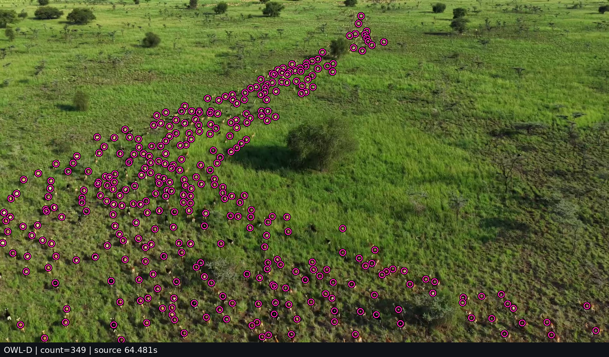

# AniCount

**Frame-by-frame wildlife counting in aerial footage of the Great Nile Migration, South Sudan.**

AniCount locates visible animals in HD video and saves the coordinates behind every marker. The current case study follows a herd filmed from an oblique angle: individuals are clearly separated in the foreground and occupy progressively fewer pixels toward the far end of the herd.

**[Watch the annotated clip · all 72 frames](outputs/owl_d_rings_20261107_124047/owl-d/annotated.mp4)** · **[Inspect the frame counts](outputs/owl_d_rings_20261107_124047/owl-d/counts.csv)** · **[Download the detection coordinates](outputs/owl_d_rings_20261107_124047/owl-d/detections.csv)**



*Frame 1546, source time 64.481 s. Each ring marks one center predicted by OWL-D. The model returned 349 locations. This still comes from a separate single-frame experiment, just after the video excerpt.* [Open the same frame without markers](outputs/probe_645/reference_frames/frame_0001546_000064.481s.png).

## What has been completed

Two OWL-D runs cover the same interval, **61.0–64.0 s**, in the 1920 × 1080 source. The first sampled every third frame for a quick preview. The second processed every source frame, reusing the 24 saved predictions and computing the remaining 48.

| Video run | Source frames | Playback rate | Detections per frame, min / median / max |
|---|---:|---:|---:|
| [Sampled preview](outputs/owl_d_rings_20261107_084409/owl-d/annotated.mp4) | 24 | 7.99 fps | 310 / 337 / 661 |
| [Full-frame-rate video](outputs/owl_d_rings_20261107_124047/owl-d/annotated.mp4) | 72 | 23.98 fps | 310 / 336.5 / 661 |

The full run covers consecutive source frames **1463–1534**. Its median of 336.5 is a summary across 72 integer counts. Each count describes detections visible at one time, so summing the rows would repeatedly count animals that remain in view. Species labels, persistent animal identities, and manually verified accuracy are outside the current outputs.

### What the comparison models produced

| Model | Output | Recorded result |
|---|---|---|
| **OWL-D** | Center points and a localization heatmap | 349 points on HD frame 1546. Also used for both annotated clips. |
| **OWL-C** | Center points and a localization heatmap | 155 points on the same HD frame. The [OWL-C output](outputs/probe_645/owl-c/frames/frame_0001546_000064.481s.png) can be inspected alongside the OWL-D image above. |
| **DroneMegaDetector** | Animal bounding boxes | The HD frame-1546 CPU run stopped with `std::bad_alloc` before producing a count. A separate screen-recording test completed with 290 boxes at inference size 640 and 218 at size 1280. |

The difference between 155 and 349 is **model disagreement on identical image content**. Determining which additional points correspond to animals requires a reference annotation. The DroneMegaDetector figures come from a different image and are reported separately in the [screen-recording test record](example_results/validation.json). The [HD experiment summary](outputs/probe_645/summary.json) records the status of all three models, including the failed run.

## How the point-counting pipeline works

1. **Select source frames.** The video reader converts the requested time interval into source-frame indices. Each result retains its original index and timestamp.
2. **Run the detector on overlapping tiles.** The published OWL-D configuration uses 512 × 512 pixel tiles with 160 pixels of overlap. Processing tiles preserves the source pixel scale of distant animals.
3. **Combine the localization maps.** Responses are averaged where tiles overlap. Peaks are extracted once from the combined map, and the published run retains peaks with scores of at least 0.20.
4. **Export and render.** Each retained peak becomes a source-image coordinate and a ring in the annotated video. The coordinates, frame counts, and run configuration are saved separately so that individual detections can be inspected or redrawn.

The general pretrained OWL-D checkpoint comes from [Microsoft MegaDetector-Overhead](https://github.com/microsoft/MegaDetector-Overhead). AniCount applies the released model to South Sudan footage without local fine-tuning. The rings visualize predicted centers; their radius is a display setting and carries no estimate of body size.

## Repository guide

| Path | What it contains |
|---|---|
| [`owl_video.py`](owl_video.py) | Builds an annotated clip from the HD source, reuses complete cached frames, and computes missing predictions. |
| [`highlight_owl.py`](highlight_owl.py) | Redraws saved OWL coordinates as visible rings on a selected source frame. |
| [`anicount_video.py`](anicount_video.py) | Main inference runner for DroneMegaDetector, OWL-C, and OWL-D. |
| [`outputs/probe_645/`](outputs/probe_645/) | Same-frame model experiment: original image, heatmaps, point predictions, per-model logs, and summary. |
| [`outputs/owl_d_rings_20261107_124047/`](outputs/owl_d_rings_20261107_124047/) | Complete 72-frame run: MP4, detections, counts, settings, and first/last reference frames. |
| [`full_frame_bbox/`](full_frame_bbox/) | Earlier bounding-box experiment with an annotated still, video, and machine-readable detections. |
| [`probe_original/`](probe_original/), [`probe_scale/`](probe_scale/), [`probe_herdnet/`](probe_herdnet/) | Exploratory results for cropped imagery, changes in scale, and center detection at different thresholds. |
| [`box_animals.py`](box_animals.py), [`probe_herdnet.py`](probe_herdnet.py) | Scripts used during the earlier detector experiments. |
| [`download_anicount_resources.py`](download_anicount_resources.py) | Resource downloader with a [manifest](download_manifest.json) and [download report](download_report.json). |
| [`anicount_vendor/`](anicount_vendor/) | Inference components used by the OWL models. |

## Reproduce the full-frame-rate clip

The published results can be inspected directly from the links above. To rerun inference, the commands below assume the existing AniCount environment, source video, and OWL-D checkpoint on the project server.

```text
/home/tahiti/AniCount/
├── .venv_anicount/
├── NG South Sudan 1920x1080 (1).m4v.mp4
├── weights/OWL-D.pth
├── anicount_vendor/
├── anicount_video.py
├── highlight_owl.py
└── owl_video.py
```

```bash
cd /home/tahiti/AniCount
.venv_anicount/bin/python -u owl_video.py \
  --start 61 --end 64 --stride 1 \
  --device cpu --threads 4 --radius 10
```

`--stride 1` selects every source frame. `--stride 3` reproduces the sampling rate of the shorter preview while preserving the three-second playback duration. The runner prints the output path and the number of reusable frames at startup. With `--device auto`, it checks available GPU memory before loading OWL-D and selects CPU when less than 8 GiB is free.

To change the appearance of the **existing** single-frame result, use the saved coordinates:

```bash
cd /home/tahiti/AniCount
.venv_anicount/bin/python highlight_owl.py \
  --run outputs/probe_645 --at 64.5 --radius 10
```

## Research directions

**1. Explain the largest count change in the published clip.** Frame 1463 contains 661 predictions at 61.019 s. The next frame contains 346 at 61.061 s. The first frame was reused from the sampled run. Comparing the two decoded source images, their point maps, and a fresh prediction for frame 1463 would distinguish a change in image content from detector sensitivity or a frame-alignment issue. The published CSV establishes the discrepancy; its cause remains open.

**2. Measure where animals become difficult to separate.** In an oblique view, distant animals may be both smaller and closer together in the image. A reference set drawn from several independent camera shots would allow recall to be measured jointly against apparent body length in pixels and nearest-neighbor distance in body lengths. This would show which combinations of scale and crowding account for missed animals.

**3. Test how much a plausible count can hide.** A missed animal inside the herd and a false detection on vegetation can cancel in the frame total. Independently marked animal centers would support one-to-one matching and separate estimates of false positives, false negatives, localization F1, and absolute count error. OWL-C, OWL-D, and bounding-box centers could then be compared on exactly the same frames.

**4. Evaluate temporal consistency within continuous shots.** Short manually annotated tracks would allow measurement of marker jitter, missed detections that reappear, and track fragmentation as the camera moves. Estimating unique animals crossing a specified line would require validated tracks and a clearly defined counting interval.

The current release provides a reproducible sequence of detections and the source-frame references needed to audit them. The next research milestone is an independently annotated set of shots from the migration footage, with separate evaluation of localization, counting error, and temporal consistency.
